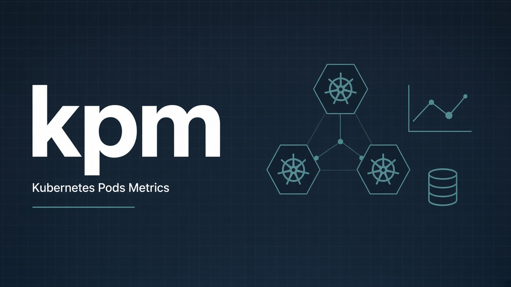
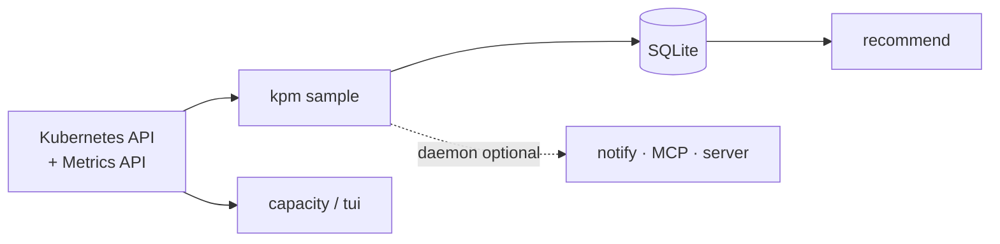

# kpm — Kubernetes Pods Metrics

<a id="top"></a>

[](https://github.com/hrodrig/kpm/releases)
[](https://github.com/hrodrig/kpm/releases)
[](./LICENSE)
[](https://go.dev/dl/)
[](https://github.com/hrodrig/kpm/actions/workflows/ci.yml)
[](https://github.com/hrodrig/kpm/actions/workflows/security.yml)
[](https://github.com/hrodrig/kpm/actions/workflows/codeql.yml)
[](https://gghstats.hermesrodriguez.com/hrodrig/kpm)
[](https://pkg.go.dev/github.com/hrodrig/kpm)
[](https://deps.dev/go/github.com%2Fhrodrig%2Fkpm)

**Repo:** [github.com/hrodrig/kpm](https://github.com/hrodrig/kpm) · **Releases:** [GitHub Releases](https://github.com/hrodrig/kpm/releases) · **Spec:** [SPECIFICATIONS.md](SPECIFICATIONS.md) · **Roadmap:** [docs/ROADMAP.md](docs/ROADMAP.md) · **Operator:** [kpm-selfhosted](https://github.com/hrodrig/kpm-selfhosted) · **Changelog:** [CHANGELOG.md](CHANGELOG.md) · **Contributing:** [CONTRIBUTING.md](CONTRIBUTING.md)

<a id="early-development-disclaimer"></a>

> **Early development (pre-1.0).** kpm is under active development.
> [SPECIFICATIONS.md](SPECIFICATIONS.md) is **draft v0.4**: Core, Insights,
> notifications, MCP (§1–7), and server charts (§8) are **normative in-tree**.
> Recommendations are **advisory** — you own production resource changes.
> **Use at your own risk.** The software is provided under the
> [MIT License](./LICENSE) **“AS IS”**, without warranty of any kind
> (see [LICENSE](./LICENSE)).

**The problem:** Cluster CPU/memory **requests** often dwarf real utilization
(oversizing). Snapshots (`kubectl top`, kube-capacity) lack history. Full
Prometheus + VPA/Goldilocks stacks are heavy for a laptop/bastion workflow.

**How kpm solves it:** a single-binary CLI (**client-go**, no `kubectl`
subprocess) that samples pod CPU/memory into **local SQLite** and surfaces
**rightsizing recommendations** (rules over historical p95 vs requests/limits),
plus capacity/TUI and optional notify/MCP/**server charts** — see the SPEC.
Bastion-first; in-cluster packaging later via
**[kpm-selfhosted](https://github.com/hrodrig/kpm-selfhosted)** (same product vs
operator split as [kwd](https://github.com/hrodrig/kwd) / [kzero](https://github.com/hrodrig/kzero) / [groot](https://github.com/hrodrig/groot)).

### What’s new in 0.6 — analyze-local charts

Copy the SQLite store to a laptop, run **`kpm serve`**, open charts —
**no sample loop required**. Optional live Metrics when kubeconfig works.

- Workload cards + time windows; oversized / undersized badges from stored recommend
- JSON `GET /api/v1/*` · GitOps patch copy/download (**never** applied)
- Mode chip `live` / `analyze-local` · advisory footer (you own production changes)

Contract: **[SPEC §8](SPECIFICATIONS.md)** · band notes: **[plan-0.6.0](docs/plan-0.6.0.md)** ·
shipped list: **[CHANGELOG](CHANGELOG.md)**



**Related tools (same maintainer):**
- **[kpm](https://github.com/hrodrig/kpm)** — Kubernetes Pods Metrics (this repo; deploy: [kpm-selfhosted](https://github.com/hrodrig/kpm-selfhosted))
- **[kwd](https://github.com/hrodrig/kwd)** — Kubernetes workload readiness watchdog ([live traffic](https://gghstats.hermesrodriguez.com/hrodrig/kwd); deploy: [kwd-selfhosted](https://github.com/hrodrig/kwd-selfhosted))
- **[kzero](https://github.com/hrodrig/kzero)** — bastion-first declarative workload reset ([live traffic](https://gghstats.hermesrodriguez.com/hrodrig/kzero); deploy: [kzero-selfhosted](https://github.com/hrodrig/kzero-selfhosted))
- **[groot](https://github.com/hrodrig/groot)** — Kubernetes diagnostics archive ([live traffic](https://gghstats.hermesrodriguez.com/hrodrig/groot); deploy: [groot-selfhosted](https://github.com/hrodrig/groot-selfhosted))
- **[pgwd](https://github.com/hrodrig/pgwd)** — PostgreSQL connection watchdog ([live traffic](https://gghstats.hermesrodriguez.com/hrodrig/pgwd); deploy: [pgwd-selfhosted](https://github.com/hrodrig/pgwd-selfhosted))
- **[gghstats](https://github.com/hrodrig/gghstats)** — GitHub repo traffic beyond 14 days ([live demo](https://gghstats.hermesrodriguez.com); deploy: [gghstats-selfhosted](https://github.com/hrodrig/gghstats-selfhosted))

**Releases** will ship **binaries**, **`.deb`** / **`.rpm`**, and
**`ghcr.io/hrodrig/kpm`** (Cosign + SBOM via GoReleaser) once tagged from
`main`. Behavior contract: **[SPECIFICATIONS.md](SPECIFICATIONS.md)**.

## Table of contents

- [Early development disclaimer](#early-development-disclaimer)
- [What’s new in 0.6](#whats-new-in-06--analyze-local-charts)
- [How it works](#how-it-works)
- [Status](#status)
- [Roadmap](#roadmap)
- [Quick start](#quick-start)
- [Development](#development)
- [License](#license)

---

## How it works

kpm is **history-first**: sample control-plane metrics into **local SQLite**,
then recommend rightsizing offline (no auto-apply). Daemon ticks **always**
persist metrics; notifications / MCP / HTTP charts are optional facades.



Details (bands, defaults, more diagrams):  
**[docs/measurement-and-rightsizing.md](docs/measurement-and-rightsizing.md)** ·  
**[SPECIFICATIONS.md](SPECIFICATIONS.md)** ·  
**[docs/ROADMAP.md](docs/ROADMAP.md)**

[↑ Back to top](#top)

---

## Status

| Area | State |
|------|--------|
| Repo mold (Make, CI, GoReleaser, man, whitelist `.gitignore`) | **Done** (`v0.1.0`) |
| `kpm version` / `--print-sample-config` | **Done** |
| Core: sample → SQLite, backup, export | **In tree** — band `0.2.x` (`sample` / `backup` / `export`; [ROADMAP](docs/ROADMAP.md)) |
| `kubectl kpm` plugin shim | **Done** (`make install-kubectl-plugin` / release binary) |
| FreeBSD / OpenBSD port skeletons | **In tree** (`contrib/freebsd/`, `contrib/openbsd/`) |
| VHS `docs/demo.gif` | **In tree** (re-record on VERSION bump) |
| `kpm capacity` (live table) | **In tree** (`0.3.x #8`/`#10`) |
| `kpm tui` / `capacity --tui` | **In tree** (`0.3.x #11`; Δ vs recommend — SPEC §5.3.1) |
| `kpm recommend` (offline) | **In tree** (`0.3.x #9` / `#9b`) |
| Notifications (multi-sink) | **In tree** (`0.4.x #12`–`#15`; `notify-test`) |
| MCP (`kpm mcp` + daemon HTTP/SSE) | **In tree** (`0.5.x #16a`/`#16`/`#17`) |
| Server charts / JSON API (`kpm serve`) | **In tree** (`v0.6.0` — [plan-0.6.0](docs/plan-0.6.0.md); SPEC §8) |
| Homebrew / Krew / `kpm-selfhosted` | Deferred |

[↑ Back to top](#top)

---

## Roadmap

Path to **v1.0.0** (full SPEC stack): **[docs/ROADMAP.md](docs/ROADMAP.md)**.  
Core band plan: **[docs/plan-0.2.0.md](docs/plan-0.2.0.md)**.

[↑ Back to top](#top)

---

## Quick start

```bash
make build
./bin/kpm version
./bin/kpm --print-sample-config > kpm.yml
./bin/kpm --help
# After samples (or a copied store): analyze-local charts — see SPEC §8
# ./bin/kpm serve --config ./kpm.yml
```

### kubectl plugin

Same binary under the `kubectl-` prefix → `kubectl kpm …`:

```bash
make install-kubectl-plugin   # installs kubectl-kpm to $(BINDIR), default /usr/local/bin
kubectl kpm version
kubectl kpm sample --config ./kpm.yml
```

GoReleaser ships both `kpm` and `kubectl-kpm`. Krew index deferred.

[↑ Back to top](#top)

---

## Development

```bash
make lint
make test
make cover-check
```

BSD port skeletons: `contrib/freebsd/`, `contrib/openbsd/` — sync with
`make port-freebsd-sync` / `make port-openbsd-sync`.  
Terminal demo: `docs/demo.tape` → `docs/demo.gif` (re-record with VHS on VERSION bump).

Before a release tag: **`make release-check`**.

[↑ Back to top](#top)

---

## License

[MIT](./LICENSE)

[↑ Back to top](#top)
