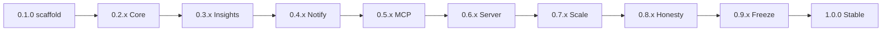

# Roadmap — kpm

Product path from scaffold to **v1.0.0**. Behavior contract:
[SPECIFICATIONS.md](../SPECIFICATIONS.md). Shipped history:
[CHANGELOG.md](../CHANGELOG.md). Band plans (when needed): `docs/plan-0.Y.Z.md`.

**v1.0 cut (decided):** tag `v1.0.0` only when CORE + adjacent
(`recommend`, `capacity`, `tui`) + optional facades (notifications
multi-sink, MCP stdio+HTTP, server embedded charts) are **stable and
normative**. `kpm-selfhosted` (cron/Helm) is out of band — does not block 1.0.

**Last reviewed:** 2026-10-16

---

## Current focus

| Band | Focus | Plan |
|------|-------|------|
| **0.2.x–0.7.x** | Core → Insights → Notify → MCP → Server → Scale | shipped `v0.2.0`–`v0.7.0` |
| **Current** | **0.8.x Honesty** (thin) then **0.9.x Freeze** → **1.0.0** | [plan-0.8.0.md](./plan-0.8.0.md) |

Scale band detail: [plan-0.7.0.md](./plan-0.7.0.md) (`v0.7.0`).

---

## Semver bands

| Band | SPEC | Status |
|------|------|--------|
| **0.1.x** Scaffold | mold + CLI version/sample-config | **Shipped** `v0.1.0` |
| **0.2.x** Core (P1) | §2 sample, store, daemon sample-only, backup, export | **In tree** (SPEC draft v0.4 normative Core) |
| **0.3.x** Insights (P2) | §3–5 recommend, capacity, tui | **Shipped** `v0.3.0` |
| **0.4.x** Notify (P3) | §6 thresholds + multi-sink (slack/webhook/smtp) | **Shipped** `v0.4.0` |
| **0.5.x** MCP (P4) | §7 stdio + HTTP/SSE + ops mux | **Shipped** `v0.5.0` |
| **0.6.x** Server (P5) | §8 analyze-local + charts + JSON API (no SPA) | **Shipped** `v0.6.0` |
| **0.7.x** Scale | nodes snap `#20b` + UI search `#20c` + store caps + serve harden | **Shipped** `v0.7.0` |
| **0.8.x** Honesty | retention/coverage/target/doctor (`#24`–`#28`) + pulled-forward `#30`–`#32` | **In progress** |
| **0.9.x** Freeze | E2E/docs/security/packaging (`#20`–`#23`, `#29`) | Planned |
| **1.0.0** Stable | Full SPEC surface normative | Planned |

[↑ Back to top](#top)

---

## Global work items

IDs are **stable across bands**. Cite in CHANGELOG as `(0.X.x #N)`.

> **Number reuse (known, deliberate):** `#24`, `#25` and `#26` were used by the
> shipped 0.2.x band and were re-used by the 0.8.x band when it was drafted. Both
> meanings are live: `CHANGELOG.md` and [plan-0.2.0.md](./plan-0.2.0.md) cite the
> 0.2.x items, while [plan-0.7.0.md](./plan-0.7.0.md) and this file cite the 0.8.x
> items. The 0.2.x numbers are **retired** — they stay in the historical record and
> must not be reassigned, but no new item uses them. From 0.8.x onward every new
> item takes the next number **past the current maximum (`#29`)**: `#30`, `#31`, …

### Shipped — 0.1.x

| ID | Item | Status |
|----|------|--------|
| — | Repo mold, `kpm version`, `--print-sample-config`, SPEC draft v0.3 | Done (`v0.1.0`) |

### 0.2.x — Core (P1)

| ID | Item | Status |
|----|------|--------|
| `#1` | Config load (`kpm.yaml`, Viper) + validation for `cluster` / `kube` / `client` / `store` / `sample` / `scope`; `client.id` cascade | **Done** (in tree) |
| `#2` | client-go Metrics + Pods; `kpm sample` one-shot → SQLite | **Done** (one-shot; daemon → `#4`) |
| `#3` | Schema version + retention prune + indexes | **Done** (in tree) |
| `#4` | Daemon loop (`interval_seconds > 0`) sample-only; SIGINT/TERM clean | **Done** (in tree) |
| `#5` | `kpm backup` (SQLite `VACUUM INTO`) | **Done** (in tree) |
| `#6` | `kpm export` csv/tsv + filters | **Done** (in tree) |
| `#7` | Exit codes 0/1/2 for cluster/RBAC fail-closed | **Done** (exit `2` wired) |
| `#24` | FreeBSD + OpenBSD port skeletons + `make port-*-sync` / `dist-*` | **Done** (in tree) — *number retired* |
| `#25` | VHS `docs/demo.tape` + `docs/demo.gif` (offline Core CLI demo) | **Done** (in tree) — *number retired* |
| `#26` | Document `kubectl kpm` plugin (`install-kubectl-plugin`, man, README) | **Done** (in tree) — *number retired* |

**Success:** fixtures or kind+metrics-server path; SPEC §2 normative; cover ≥ 80%.

### 0.3.x — Insights (P2)

| ID | Item | Status |
|----|------|--------|
| `#8` | Shared read model (live snapshot helpers) | **In tree** (`internal/live`) |
| `#9` | `kpm recommend` (dual grain, p/0.70, offline) | **In tree** (`kpm recommend`) |
| `#9b` | Persist recommend + score + **TUI delta feed** (**P2 required**) | **In tree** (`--record` / `--score`) |
| `#10` | `kpm capacity` table | **In tree** (`kpm capacity`) |
| `#11` | `kpm tui` (+ `capacity --tui`): heatmap + delta vs last recommend | **In tree** (`kpm tui`) |
| `#11b` | TUI Enter: owner template (Deploy/STS/DS) vs live Pod resources | **In tree** (Enter detail) |

**Band plan:** [docs/plan-0.3.0.md](./plan-0.3.0.md).

**Success (P2 exit):** `#8`–`#11` **and** `#9b`; SPEC §3–5 normative; VHS if help/UX change.
TUI **must** show deviation vs last recommendation when a `#9b` snapshot exists.

### 0.4.x — Notifications (P3)

Checklist detail: [plan-0.4.0.md](./plan-0.4.0.md) (`[x]`/`[ ]` — keep history).

| ID | Item | Status |
|----|------|--------|
| `#12` | Rule engine (hold / repeat / resolve / dedupe) | **Done** (`v0.4.0`) |
| `#13` | Built-in 80% defaults + startup log when rules empty | **Done** (`v0.4.0`) |
| `#14` | Multi-sink fan-out: `slack`, `webhook` (`generic`/`discord`/`teams`), `smtp`; fail-closed `*_env` | **Done** (`v0.4.0`) |
| `#15` | `kpm notify-test` | **Done** (`v0.4.0`) |

**Success:** SPEC §6 normative; daemon + notify without MCP/server.
**Note:** PagerDuty via generic `webhook` (no native type). Loki deferred.

### 0.5.x — MCP (P4)

Checklist detail: [plan-0.5.0.md](./plan-0.5.0.md) (`[x]`/`[ ]` — keep history).

| ID | Item | Status |
|----|------|--------|
| `#16a` | Shared daemon HTTP mux (`internal/httpserver`): `/healthz`, `/readyz`, process `/metrics`; listen via `mcp.listen` | **Done** (`v0.5.0`) |
| `#16` | `kpm mcp` stdio read-only store tools (`list_samples`, `summarize_window`, `list_recommendations`, `get_status`) | **Done** (`v0.5.0`) |
| `#17` | HTTP/SSE on same mux when `mcp.enabled`; bearer + gghstats-style access control (SPEC §7.2) | **Done** (`v0.5.0`) |

**Success:** SPEC §7 normative; ops probes on MCP listen; core unaware of MCP.
**Non-goal this band:** REST `/api/*` / charts (→ P5); Prometheus re-export of pod metrics; live-cluster MCP tools.

### 0.6.x — Server (P5)

Checklist detail: [plan-0.6.0.md](./plan-0.6.0.md) (`[x]`/`[ ]` — keep history).

| ID | Item | Status |
|----|------|--------|
| `#19a` | Facade listen / `kpm serve` **without** sample loop (analyze-local) | **Done** (PR) |
| `#19` | JSON `/api/v1/*` + bearer; shared read model; optional live | **Done** (PR) |
| `#18` | Embedded charts UI (history + drawers + time windows) on shared mux | **Done** (PR) |
| `#18b` | Recommend UI: **Kustomize patch/diff** copy/download (no cluster apply) | **Done** (PR) |
| `#18c` | Cards + summary: oversized / undersized / ok / no-req from recommend store | **Done** (PR) |

**Success:** SPEC §8 normative (incl. analyze-local + §8.3/§8.4); **no** SPA/npm app.
**Note:** Primary story = copy SQLite to laptop → charts/MCP/HTTP with collection off; kube live is optional enrichment.
**Non-goal:** server/CLI applying CPU/mem patches live (GitOps overwrites) — SPEC §15.9.
Visual guidance for templates: [ai-design-skills](https://github.com/elayadesign/ai-design-skills)
(Part B tokens) + [Hallmark](https://github.com/nutlope/hallmark) (anti-slop audit) —
see [plan-0.6.0 Visual guidance](./plan-0.6.0.md#visual-guidance); no SPA/npm;
no landing funnel. Marketing sites (`kpm-webs`) stay a separate repo.

### 0.7.x — Scale

| ID | Item | Status |
|----|------|--------|
| `#20b` | Node / capacity under-demand SQLite snapshots + analyze-local panel | **Shipped** `v0.7.0` |
| `#20c` | Serve UI **search/filter** (ns / owner / grain / verdict) for large grids | **Shipped** `v0.7.0` |
| — | Store SQL LIMIT / indexes; series batch; rate-limit vs static UI | **Shipped** `v0.7.0` |
| — | Harden leftovers (SMTP deadline, sample retry budget, `allowed_hosts`, WAL modes, CronJob patch, RS→Deploy) | **Shipped** `v0.7.0` |

Plan: [plan-0.7.0.md](./plan-0.7.0.md). **Shipped** `v0.7.0`.

### 0.8.x — Honesty (thin)

Plan: [plan-0.8.0.md](./plan-0.8.0.md). **In progress** (opened 2026-10-16).

| ID | Item | Issue | Status |
|----|------|-------|--------|
| `#24` | Fail load when `retention_days` < recommend window | [#87](https://github.com/hrodrig/kpm/issues/87) | **Open** |
| `#25` | Separate CPU vs memory `target_utilization` | — | Planned |
| `#26` | Window coverage by days-with-samples | — | Planned |
| `#27` | Percentile / `--score` docs first-class | — | Planned |
| `#28` | `kpm doctor` (metrics-server / store / history) | — | Planned |
| `#30` | Rate-limit buckets grouped by IPv6 `/64` | [#88](https://github.com/hrodrig/kpm/issues/88) | **Open** |
| `#31` | SMTP `Subject` RFC 2047 + CR/LF rejection + `require_starttls` | [#89](https://github.com/hrodrig/kpm/issues/89) | **Open** |
| `#32` | Release fails unless the tag is on `main`; scope workflow permissions | [#90](https://github.com/hrodrig/kpm/issues/90) | **Open** |

**Why `#30`–`#32` are here:** pulled forward from the 0.9.x Freeze parked list
(Claude 2026-10-14 re-audit). Each is a closed-scope correctness gap with a
one-file centre of gravity; leaving them in Freeze risked shipping `v1.0.0` with
them still open. `#22` keeps the remaining security-pass and RBAC items.

**Success:** every number kpm prints is backed by the configuration it needs — no
retention/window conflict, no rotatable rate limit, no unencoded SMTP header, no
tag that publishes a non-`main` state.

### 0.9.x — Freeze toward 1.0

| ID | Item | Status |
|----|------|--------|
| `#20` | Integration/E2E smoke (matrix may stay thin) | Planned |
| `#21` | Docs freeze: SPEC → normative v1.0; man pages; sample config complete | Planned |
| `#22` | Security pass; minimal RBAC ClusterRole example in docs (not Helm) | Planned |
| `#23` | Homebrew tap (deferred from 0.1) if still wanted | Planned |
| `#29` | CLI + SQLite schema freeze notes; 0.x → 1.0 migration notes | Planned |

**Moved out of 0.9 → 0.8.x:** the parked re-audit items (IPv6 `/64`, SMTP RFC 2047 /
`require_starttls`, release tag guard) now ship as `#30`–`#32`.

**Success:** no open draft on shipped surface; `make release-check` + Security green.

### 1.0.0 — Stable

- Version cut + annotated tag on `main` (may skip a public `v0.9.0` tag after freeze lands).
- Semver promise: no breaking CLI/config without major.
- **Post-1.0 (not blocking):** json export, mTLS, `kpm-selfhosted`, history-in-TUI.

[↑ Back to top](#top)

---

## Process

1. Work on topic branches from `develop`; PR into `develop`.
2. Large bands get `docs/plan-0.Y.Z.md` (merge order + success criteria).
3. Promote SPEC sections to **Normative** as each band ships.
4. Never tag `main` / run GoReleaser without explicit operator approval.

[↑ Back to top](#top)
