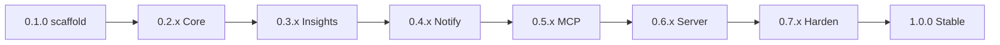

# Roadmap — kpm

Product path from scaffold to **v1.0.0**. Behavior contract:
[SPECIFICATIONS.md](../SPECIFICATIONS.md). Shipped history:
[CHANGELOG.md](../CHANGELOG.md). Band plans (when needed): `docs/plan-0.Y.Z.md`.

**v1.0 cut (decided):** tag `v1.0.0` only when CORE + adjacent
(`recommend`, `capacity`, `tui`) + optional facades (notifications webhook,
MCP stdio+HTTP, server embedded charts) are **stable and normative**.
`kpm-selfhosted` (cron/Helm) is out of band — does not block 1.0.

**Last reviewed:** 2026-10-11

---

## Current focus

| Band | Focus | Plan |
|------|-------|------|
| **0.2.x Core** | P1 `#1`–`#7` **done in-tree** — PR then version cut | [plan-0.2.0.md](./plan-0.2.0.md) |
| **Next** | **0.3.x Insights** (`#8`–`#11`) after Core lands on `develop` | — |

---

## Semver bands

| Band | SPEC | Status |
|------|------|--------|
| **0.1.x** Scaffold | mold + CLI version/sample-config | **Shipped** `v0.1.0` |
| **0.2.x** Core (P1) | §2 sample, store, daemon sample-only, backup, export | **In tree** (SPEC draft v0.4 normative Core) |
| **0.3.x** Insights (P2) | §3–5 recommend, capacity, tui | Planned |
| **0.4.x** Notify (P3) | §6 webhook thresholds | Planned |
| **0.5.x** MCP (P4) | §7 stdio + HTTP/SSE | Planned |
| **0.6.x** Server (P5) | §8 embedded charts (no SPA) | Planned |
| **0.7.x** Harden | E2E, docs freeze, security, Homebrew | Planned |
| **1.0.0** Stable | Full SPEC surface normative | Planned |

[↑ Back to top](#top)

---

## Global work items

IDs are **stable across bands**. Cite in CHANGELOG as `(0.X.x #N)`.

### Shipped — 0.1.x

| ID | Item | Status |
|----|------|--------|
| — | Repo mold, `kpm version`, `--print-sample-config`, SPEC draft v0.3 | Done (`v0.1.0`) |

### 0.2.x — Core (P1)

| ID | Item | Status |
|----|------|--------|
| `#1` | Config load (`kpm.yaml`, Viper) + validation for `cluster` / `kube` / `client` / `store` / `sample` / `scope`; `client.id` cascade | **Done** (in tree) |
| `#2` | client-go Metrics + Pods; `kpm sample` one-shot → SQLite | **Done** (one-shot; daemon → `#4`) |
| `#3` | Schema version + retention prune + indexes | **Done** (in tree) |
| `#4` | Daemon loop (`interval_seconds > 0`) sample-only; SIGINT/TERM clean | **Done** (in tree) |
| `#5` | `kpm backup` (SQLite `VACUUM INTO`) | **Done** (in tree) |
| `#6` | `kpm export` csv/tsv + filters | **Done** (in tree) |
| `#7` | Exit codes 0/1/2 for cluster/RBAC fail-closed | **Done** (exit `2` wired) |
| `#24` | FreeBSD + OpenBSD port skeletons + `make port-*-sync` / `dist-*` | **Done** (in tree) |
| `#25` | VHS `docs/demo.tape` + `docs/demo.gif` (offline Core CLI demo) | **Done** (in tree) |
| `#26` | Document `kubectl kpm` plugin (`install-kubectl-plugin`, man, README) | **Done** (in tree) |

**Success:** fixtures or kind+metrics-server path; SPEC §2 normative; cover ≥ 80%.

### 0.3.x — Insights (P2)

| ID | Item | Status |
|----|------|--------|
| `#8` | Shared read model (live snapshot helpers) | Planned |
| `#9` | `kpm recommend` (dual grain, p/0.70, offline) | Planned |
| `#10` | `kpm capacity` table | Planned |
| `#11` | `kpm tui` (+ `capacity --tui`): heatmap list, sort, refresh | Planned |

**Success:** SPEC §3–5 normative; re-record VHS if CLI help strings change.

### 0.4.x — Notifications (P3)

| ID | Item | Status |
|----|------|--------|
| `#12` | Rule engine (hold / repeat / resolve / dedupe) | Planned |
| `#13` | Built-in 80% defaults + startup log when rules empty | Planned |
| `#14` | Webhook sink (`url_env`, fail closed) | Planned |
| `#15` | `kpm notify-test` | Planned |

**Success:** SPEC §6 normative; daemon + notify without MCP/server.

### 0.5.x — MCP (P4)

| ID | Item | Status |
|----|------|--------|
| `#16` | `kpm mcp` stdio read-only tools | Planned |
| `#17` | HTTP/SSE in daemon when `mcp.enabled`; bearer rules | Planned |

**Success:** SPEC §7 normative.

### 0.6.x — Server (P5)

| ID | Item | Status |
|----|------|--------|
| `#18` | Embedded `net/http` + templates/HTMX charts | Planned |
| `#19` | Optional bearer auth; shared read model with capacity | Planned |

**Success:** SPEC §8 normative; **no** SPA/npm app in this repo.
Visual guidance for templates may borrow values from external design skills
(e.g. [ai-design-skills](https://github.com/elayadesign/ai-design-skills));
marketing sites (`kpm-webs`) are a separate repo.

### 0.7.x — Harden toward 1.0

| ID | Item | Status |
|----|------|--------|
| `#20` | Integration/E2E matrix (one-shot, daemon, recommend, tui, notify, mcp, server) | Planned |
| `#21` | Docs freeze: SPEC → normative v1.0; man pages; sample config complete | Planned |
| `#22` | Security pass; minimal RBAC ClusterRole example in docs (not Helm) | Planned |
| `#23` | Homebrew tap (deferred from 0.1) if still wanted | Planned |

**Success:** no open draft on shipped surface; `make release-check` + Security green.

### 1.0.0 — Stable

- Version cut + annotated tag on `main`.
- Semver promise: no breaking CLI/config without major.
- **Post-1.0 (not blocking):** Slack sinks, json export, mTLS, `kpm-selfhosted`, history-in-TUI.

[↑ Back to top](#top)

---

## Process

1. Work on topic branches from `develop`; PR into `develop`.
2. Large bands get `docs/plan-0.Y.Z.md` (merge order + success criteria).
3. Promote SPEC sections to **Normative** as each band ships.
4. Never tag `main` / run GoReleaser without explicit operator approval.

[↑ Back to top](#top)
