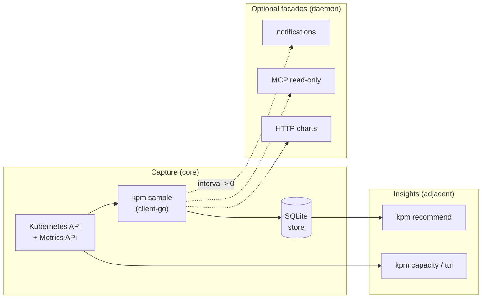
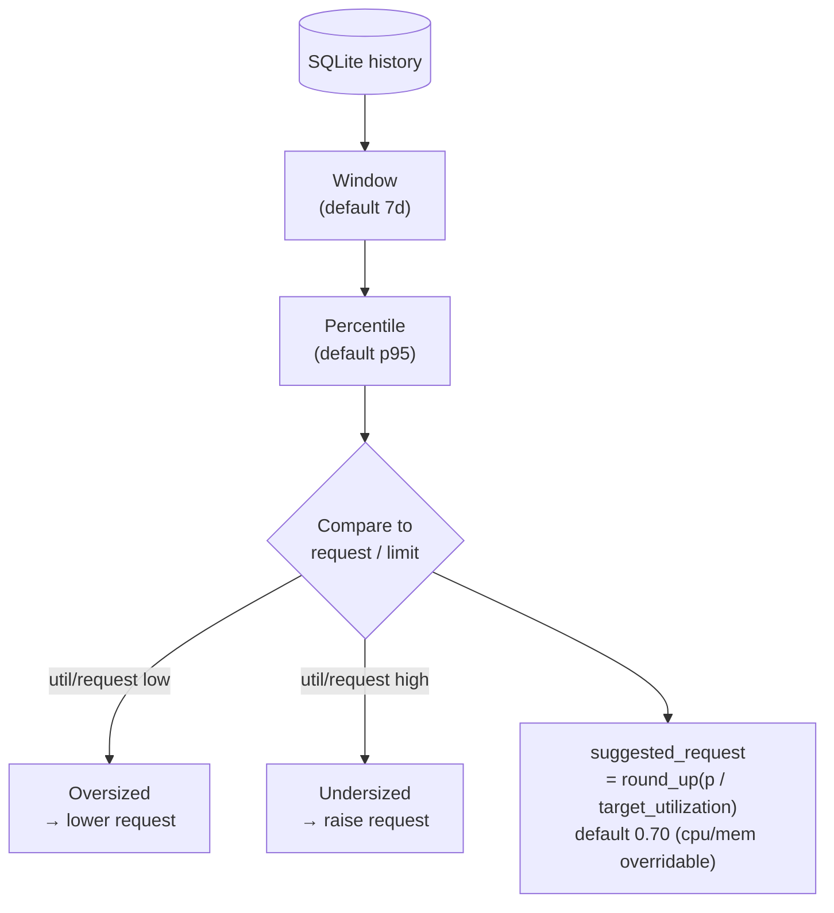

# Measurement and rightsizing strategy

<a id="top"></a>

Operator-facing overview of how kpm is intended to **measure** pod resources and
**recommend** rightsizing. Normative detail lives in
[SPECIFICATIONS.md](../SPECIFICATIONS.md) (draft until implemented).

## How it works

kpm is a **history-first** rightsizing helper: capture control-plane metrics into
**local SQLite**, then analyze offline. Live tables/TUI borrow kube-capacity-like
quantities; they are not a substitute for a Prometheus stack.



| Mode | `sample.interval_seconds` | What happens |
|------|---------------------------|--------------|
| One-shot | `0` | Sample → write SQLite → exit |
| Daemon | `> 0` | Loop: **always** sample → SQLite each tick; optional notify / MCP / server if enabled |

[↑ Back to top](#top)

---

## Measurement strategy

**Sources (planned):** typed **client-go** only — Pod specs (requests/limits) +
Metrics API utilization. No `kubectl` subprocess. One process ↔ one cluster
(`kube.context`).

**Grain:** per **container** each tick: CPU/memory util, request, limit,
identities (namespace, pod, container, owner), `sampled_at` (UTC).

**Failure policy:**

| Situation | Behavior |
|-----------|----------|
| Pod missing from Metrics API | **Skip** that pod (+ counter); continue |
| API / RBAC failure | **Fail closed** (do not pretend the cluster is fine) |

**Aggregation for recommend:** prefer stable keys — **workload + container**
and **pod + container** (default: both). Pod names churn; owner refs keep
history useful across restarts.

**Retention:** SQLite at `store.path` with `retention_days` (sample default
**14**). Export **csv** / **tsv** for spreadsheets; backup while the daemon runs.

Longer retention generally yields **more representative** percentiles and
rightsizing advice: weekly/month batch jobs, Monday peaks, and deploy cycles
need enough calendar days in the store. Prefer
`retention_days` ≥ `recommend.window_days` (default window **7**). Raising
retention trades disk for statistics closer to real usage; very short
retention makes p95 noisy and recommendations less trustworthy.

| Environment | Suggested `retention_days` |
|-------------|----------------------------|
| Lab / demo | **14** (sample default) |
| Staging | **30+** |
| **Production** | **> 45** (often **60–90** if disk allows) |

**Why history beats a snapshot:** oversizing shows up as util ≪ request over
days, not in a single `kubectl top`. Undersizing / risk shows as util near
request or limit across the window.

[↑ Back to top](#top)

---

## Rightsizing recommendations

`kpm recommend` is **offline** (reads SQLite only). It does **not** mutate
workloads — suggestions only (no auto-apply).



| Idea | Default (SPEC draft) | Meaning |
|------|----------------------|---------|
| Window | `window_days: 7` | How much history to trust |
| Percentile | `percentile: 95` | Peak-ish steady use, not max spike alone |
| Target util | `target_utilization: 0.70` | Shared aim, ~70% of request after rightsize |
| Per-resource target | `cpu_target_utilization`, `memory_target_utilization` | Override the shared target; **0 or unset = inherit**. CPU throttles under a burst, memory is OOMKilled, so they are often set differently (CPU lower, memory higher) |
| Suggest | `round_up(p / <resource>_target_utilization)` | Request from observed percentile |
| CPU vs memory | Separate ratios | Do not mix dimensions |
| vs request / vs limit | Both verdicts | Limit pressure ≠ request waste |

**Rule-of-thumb bands** (aligned with recommend / TUI / notify where sensible):

| util ÷ request (stable) | Reading |
|-------------------------|---------|
| ≪ ~0.35 | Likely oversize — candidates to lower request |
| ~0.50–0.80 | Reasonable headroom |
| ≳ ~0.85 | Undersize / throttling risk — raise request |
| util near **limit** | OOM / throttle risk — do not cut limit blindly |

### TUI delta vs last recommend

After `kpm recommend --record`, `kpm tui` (delta on) shows
`live request − last suggested request`.

**Δ is only vs that snapshot** — not vs Helm/Kustomize/Git “desired”
settings, not vs limits, and not the same thing as the bar `%`
(util ÷ live request|limit).

Anonymized example (`cpu/request` mode):

```text
> app/db-0   ████████████░░  113%   Δcpu -60m   Δmem +3Mi
```

- **113%** — util above **current** request (hot now). Infra live signal.
- **Δcpu −60m** — current CPU request is 60m below **last recorded advice**.
- **Δmem +3Mi** — mem request nearly matches that same advice snapshot.

Full table: [SPECIFICATIONS.md §5.3.1](../SPECIFICATIONS.md).

**Notifications** (daemon, optional): user `rules[]`, or if empty while
`enabled: true`, built-in **CPU + memory util vs request @ 80%** plus a
one-time startup log — see SPEC §6.0.

[↑ Back to top](#top)

---

## Daemon and optional facades

When `interval_seconds > 0`, the process is a long-running collector:

1. **Always** sample → SQLite every tick  
2. **If** `notifications.enabled` → evaluate rules (user or 80% defaults)  
3. **If** `mcp.enabled` → read-only MCP HTTP in-process (`kpm mcp` for stdio)  
4. **If** `server.enabled` → embedded charts UI  

A sample-only daemon (no optional blocks) is valid. SIGINT/SIGTERM → exit `0`.

[↑ Back to top](#top)

---

## See also

- [SPECIFICATIONS.md](../SPECIFICATIONS.md) — normative contract  
- [configs/kpm.sample.yml](../configs/kpm.sample.yml) — annotated defaults  
- [README.md](../README.md) — project entry  
